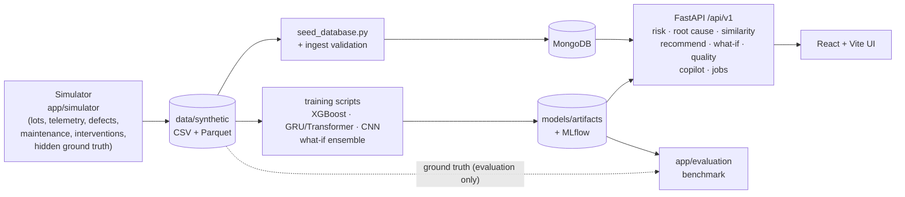

# WafGuard AI

**Decision support for semiconductor process and yield engineers:** which lots are at risk,
why, what happened during the run, what to investigate, and what a change would probably do.

> **All manufacturing data in this repository is SYNTHETIC.** Lots, wafers, sensors, defects,
> maintenance and interventions come from a seeded simulator (`backend/app/simulator/`,
> 5,000 lots). The only real dataset is the optional UCI SECOM download. Every metric below
> describes behaviour on the simulator, not accuracy in a real fab. Root causes are *ranked
> candidates with evidence*, and what-if results are *model-based estimates*, never proof.

Maintainer: Ansh Kansagra

---

## What it does

WafGuard follows one lot through the decisions an engineer makes:

| Step | Question | How it is answered | Code |
|---|---|---|---|
| 1 | Which lots about to run are risky? | Pre-run risk from information that exists **before** the run: the tool's last state, the planned recipe, maintenance age, similar historical lots. Calibrated probability + LOW / MEDIUM / HIGH. | `app/risk/` |
| 2 | Why is this lot at risk? | Calibrated XGBoost risk + yield prediction, SHAP attributions, and a multi-signal root-cause engine that ranks 10 candidates with evidence items. | `app/services/yield_service.py`, `app/services/rootcause_service.py` |
| 3 | What happened? | Event timeline (excursions, alarms, recipe transitions, maintenance, inspection), defect summary, wafer-map CNN with Grad-CAM. | `app/api/timeline.py`, `app/services/defect_service.py` |
| 4 | How do the signals connect? | Evidence graph: tool → sensor issue → mechanism → defect pattern → yield loss, from measured data plus a readable rules file. | `app/rootcause/` |
| 5 | What should I investigate? | Actions from an engineering knowledge base, each scored against the (synthetic) intervention history: "9/12 similar cases recovered", average yield change, small-sample warnings. No LLM writes actions. | `app/recommend/`, `app/knowledge/engineering_kb.yaml` |
| 6 | What if I change something? | Bootstrap-ensemble counterfactual: yield before/after as P10–P90 ranges plus an 80% interval with measured coverage. Impossible changes are blocked. | `app/whatif/` |
| 7 | Can I trust the data and models today? | Ingest validation per lot, drift (PSI + KS) vs the training data, daily model-monitoring snapshots, MLflow experiment tracking. | `app/quality/`, `app/ops/tracking.py` |
| 8 | Explain it to me | Retrieval-first copilot: every sentence cites evidence ids; says "Not enough evidence" instead of guessing. Works with no LLM. | `app/copilot/` |

## Screens

The React UI keeps all existing pages and adds four decision screens:

| Route | Screen |
|---|---|
| `/upcoming` | **Upcoming Lots**: next run per tool, sorted by risk, with the main reason |
| `/investigate?lot_id=…` | **Lot Investigation**: risk → why → what happened → what to investigate → what-if |
| `/root-cause-explorer?lot_id=…` | **Root Cause Explorer**: cause → evidence → historical cases → recommendation, plus the evidence graph |
| `/health` | **Model & Data Health**: drift, monitoring (false alarms, missed low-yield lots, calibration), ingest data quality |
| `/dashboard`, `/lots`, `/root-cause`, `/what-if`, `/alerts`, `/equipment`, `/control-charts`, … | Earlier pages, still available |

## Architecture



- **Backend:** FastAPI, Pydantic v2, PyMongo. Every route is served under the versioned
  `/api/v1` prefix (OpenAPI at `/docs`) and under `/api` as an alias. One response envelope:
  `{success, data, error: {code, message, request_id}, timestamp, api_version}`.
- **ML:** XGBoost (Optuna search, isotonic calibration), scikit-learn baselines, SHAP,
  PyTorch (GRU / Temporal Transformer on raw telemetry, wafer-map CNN + Grad-CAM, ResNet/ViT
  comparisons), bootstrap ensembles for uncertainty.
- **Jobs:** heavy work (sensor-batch validation, wafer-map batches, root-cause batches,
  upcoming-lot scoring) runs as background jobs: `POST /api/jobs` → `GET /api/jobs/{id}` →
  `GET /api/jobs/{id}/result`, with status kept in MongoDB.
- **Guard rails:** ground truth is readable only by `app/evaluation/`
  (`tests/test_ground_truth_leakage.py` fails the build otherwise); all splits are
  chronological, by lot.

## Repository layout

```
backend/
  app/
    api/            REST routers (lots, predict, lot-risk, root-cause, similarity, defects,
                    recommendations, whatif, quality, copilot, jobs, alerts, timeline, ...)
    simulator/      synthetic fab generator, causal fault mechanisms, interventions
    data_model/     typed entities: Lot → Wafer → Step → Chamber → Equipment
    features/       tabular + temporal feature engineering
    ml/             XGBoost, baselines, calibration, CV, HPO, temporal/ and vision/ models
    services/       yield, risk, root cause, similarity, defects, alerts, copilot (v1)
    risk/           upcoming-lot (pre-run) risk engine
    rootcause/      evidence graph + graph_rules.json
    recommend/      knowledge-base actions scored by intervention history
    knowledge/      engineering_kb.yaml (actions only, no numbers)
    whatif/         counterfactual engine, uncertainty ensemble, limits.json
    quality/        ingest validation, drift, model monitoring
    copilot/        retrieval-first, evidence-cited copilot (v2)
    jobs/           background job runner + tasks
    evaluation/     benchmark + the only code allowed to read ground truth
    ops/            readiness, request metrics, model warm-up, MLflow tracking
  scripts/          dataset, seeding, training, evaluation CLIs
  tests/            pytest suite (mongomock; no real database needed)
  Dockerfile
frontend/           React 18 + Vite + Tailwind + Recharts/Plotly, Vitest tests, Dockerfile
deploy/nginx.conf   serves the UI and proxies /api
docker-compose.yml  MongoDB + API + UI (+ one-shot training pipeline)
docs/               architecture, methodology, setup guide, audit, design decisions
reports/            benchmark, model comparisons, calibration/confusion plots
data/               synthetic dataset (generated), SECOM (downloaded)
```

## Quick start (local)

Prerequisites: Python 3.13, Node.js 20, MongoDB 6+ (local, or set `MONGODB_URI`).

```bash
cp .env.example .env
```

Backend dependencies:

```bash
cd backend
python -m venv .venv
.venv\Scripts\activate
pip install -r requirements.txt
```

(On Linux/macOS use `source .venv/bin/activate`.)

Frontend dependencies:

```bash
cd frontend
npm install
```

### Build the data and train every model

Run from `backend/` with the virtual environment active. The order matters: later steps read
earlier artifacts.

```bash
python scripts/download_secom.py
python scripts/build_dataset.py
python scripts/seed_database.py
python scripts/train_yield_model.py
python scripts/train_whatif_ensemble.py
python scripts/evaluate_yield_model.py
python scripts/train_wafer_model.py
python scripts/train_temporal_model.py
python scripts/build_evidence_tables.py
python -m app.evaluation.run_all
```

| Command | Produces |
|---|---|
| `download_secom.py` | real UCI SECOM data in `data/secom/` (for the SECOM classifier) |
| `build_dataset.py` | synthetic dataset in `data/synthetic/` incl. `interventions.parquet` and the hidden `ground_truth.parquet` |
| `seed_database.py` | MongoDB collections + one data-quality report per lot |
| `train_yield_model.py` | SECOM classifier, lot yield regressor + calibrated risk classifier, feature snapshot, MLflow runs; backfills predictions, alerts and monitoring snapshots into MongoDB |
| `train_whatif_ensemble.py` | 20-member uncertainty ensemble for the what-if engine |
| `evaluate_yield_model.py` | `models/artifacts/evaluation_report.json` |
| `train_wafer_model.py` | wafer-map CNN + embeddings for vision similarity |
| `train_temporal_model.py` | GRU / Transformer on raw telemetry + temporal embeddings, `reports/temporal_comparison.md` |
| `build_evidence_tables.py` | measured pattern → cause table used by the root-cause engine |
| `python -m app.evaluation.run_all` | `reports/benchmark.md` and `reports/benchmark.json` |

`python scripts/build_dataset.py --all` chains generate → seed → train → evaluate in one
command, and `python scripts/doctor.py` checks what is missing and prints the fix.
Optional comparisons: `compare_tabular_models.py`, `compare_vision_models.py`,
`evaluate_rootcause.py`. Browse experiment runs with
`mlflow ui --backend-store-uri sqlite:///mlruns/mlflow.db` from the project root.

> `train_yield_model.py` writes predictions into whatever database `MONGODB_URI` points to.
> Point it at a local or disposable database unless you mean to update a shared one.

### Run

```bash
cd backend
uvicorn app.main:app --reload --port 8000
```

```bash
cd frontend
npm run dev
```

UI at http://localhost:5173, API docs at http://localhost:8000/docs. Health probes:
`/api/health` (details), `/api/health/live`, `/api/health/ready`.

### Run with Docker

```bash
docker compose --profile bootstrap run --rm pipeline
```

```bash
docker compose up --build
```

The first command generates the data, seeds MongoDB and trains the models into the mounted
`data/` and `backend/models/artifacts/` folders; the second starts MongoDB, the API (port 8000)
and the UI (port 5173). Set `JWT_SECRET_KEY` before exposing it anywhere. The Docker files have
not yet been verified on a machine with Docker installed.

## Demo accounts

All routes except `/api/health*` and `/api/auth/login` need a bearer token.

| Username | Password | Role | Can additionally |
|---|---|---|---|
| `admin` | `wafguard-admin` | admin | everything, incl. alert channels and monitoring rebuilds |
| `engineer` | `wafguard-engineer` | process_engineer | what-if, copilot, defect analysis, data import, jobs |
| `yieldeng` | `wafguard-yield` | yield_engineer | what-if, copilot, jobs |
| `equipeng` | `wafguard-equip` | equipment_engineer | copilot, defect analysis, jobs |
| `viewer` | `wafguard-viewer` | viewer | read only |

These are demo credentials for a synthetic-data system, not secrets.

## Main API routes

| Route | Purpose |
|---|---|
| `POST /api/v1/predict` | yield + risk for a stored lot or a feature payload |
| `POST /api/v1/lot-risk`, `GET /api/v1/lot-risk/upcoming` | pre-run risk for a planned run / the upcoming queue |
| `GET /api/v1/root-cause/{lot}`, `…/graph` | ranked candidates with evidence / evidence graph |
| `GET /api/v1/similarity/{lot}` | similar historical lots (parameter, temporal and vision spaces) |
| `GET /api/v1/defects/lots/{lot}`, `POST /api/v1/defects/analyze` | defect summary / wafer-map image analysis |
| `GET /api/v1/recommendations/{lot}` | evidence-backed actions with intervention statistics |
| `POST /api/v1/whatif`, `GET /api/v1/whatif/limits` | counterfactual with uncertainty / allowed changes and limits |
| `GET /api/v1/quality/{summary,drift,monitoring}`, `GET /api/v1/quality/lots/{lot}` | data quality, drift, monitoring |
| `POST /api/v1/copilot/ask` | evidence-cited answer to a free-form question |
| `POST /api/v1/jobs`, `GET /api/v1/jobs/{id}`, `GET /api/v1/jobs/{id}/result` | background jobs |
| `GET /api/v1/lots/{lot}/timeline` | manufacturing event timeline |

Older routes (`/api/yield/predict`, `/api/lots/{id}/root-cause`, `/api/what-if`,
`/api/lots/{id}/copilot`, …) still work.

## How the numbers are produced

- **Data:** each lot is assigned a hidden fault (pressure instability, RF drift, sensor drift,
  equipment degradation, sensor dropout, recipe transition, contamination, or none). The fault
  drives a mechanism → sensor signature, wafer pattern, defect density, electrical results and
  yield loss. About 15% of lots are low-yield (< 85%). Ground truth is saved separately and used
  only for evaluation.
- **Risk score:** `0.45·P(low yield) + 0.25·parameter deviation + 0.20·equipment risk + 0.10·tool
  history` (weights in `app/config.py`); LOW ≤ 30, MEDIUM ≤ 60, HIGH above. Details in
  [docs/risk_and_rootcause_methodology.md](docs/risk_and_rootcause_methodology.md).
- **Root cause:** six weighted signals per candidate (SHAP, parameter deviation, historical
  occurrence, equipment association, wafer-pattern association, temporal shape), each backed by
  evidence items with stable ids.
- **Recommendations:** ranking = candidate score × (recovered + 1) / (cases + 2) over interventions
  recorded *before* the lot; fewer than 10 cases → warning.
- **What-if:** a sensor change shifts the run's level and keeps its shape; the ensemble spread
  gives P10–P90 and a split-conformal band gives the 80% interval.
- **Drift:** PSI over 10 reference-quantile bins plus a KS test; flagged when PSI ≥ 0.25, or
  KS p < 0.01 with PSI ≥ 0.10.

Every design choice and its trade-off is recorded in [docs/DECISIONS.md](docs/DECISIONS.md).

## Evaluation

<!-- METRICS -->

## Tests

```bash
cd backend
python scripts/download_secom.py
python scripts/train_wafer_model.py
pytest -q
```

```bash
cd frontend
npm test
```

The backend suite generates its own 1,500-lot dataset in memory, runs on `mongomock` (no
database needed) and trains into a temporary folder, so it never touches
`models/artifacts/`. It covers the simulator, the ground-truth leakage guard, every API route
and role, and the brief's acceptance checks: no future data in pre-run risk, injected drift is
detected, every copilot sentence cites retrieved evidence, impossible what-if changes are
blocked. CI (`.github/workflows/ci.yml`) runs both suites, the frontend build and a secret scan.

## Limitations

1. Everything except SECOM is simulated, and the simulator's causal story is simple. Models and
   the root-cause engine are evaluated against the same simulator that generated the data.
2. The wafer CNN is trained and tested on procedurally generated maps (WM-811K is not included);
   expect a large drop on real maps.
3. SHAP values and root-cause scores are statistical associations, not causal proof.
   Counterfactuals are model estimates; the ensemble only captures model uncertainty.
4. The intervention history is simulated, so recovery rates illustrate the method, not real
   effectiveness.
5. Background jobs run inside the API process; jobs still running when the API restarts are
   marked failed, not resumed.

## Documentation

- [docs/setup-guide.md](docs/setup-guide.md): detailed setup
- [docs/architecture.md](docs/architecture.md): components and data flow
- [docs/risk_and_rootcause_methodology.md](docs/risk_and_rootcause_methodology.md): scoring formulas
- [docs/DECISIONS.md](docs/DECISIONS.md): design decisions and trade-offs
- [docs/AUDIT.md](docs/AUDIT.md): the starting-point audit
- [reports/benchmark.md](reports/benchmark.md): evaluation benchmark
