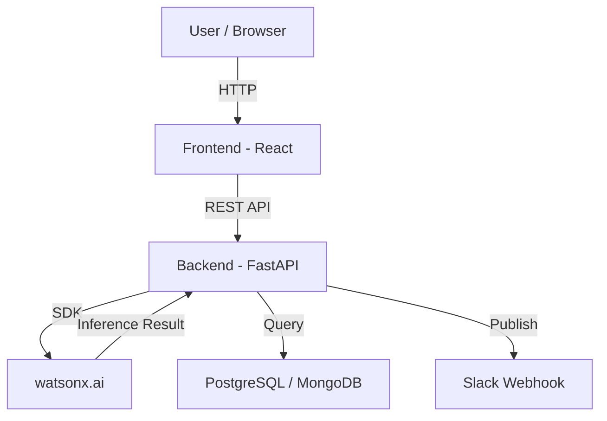

# Architecture

## System Architecture

The WafGuard AI platform uses a decoupled, microservices-ready multi-tier architecture designed for real-time semiconductor yield prediction, root-cause candidate ranking, and wafer defect pattern analysis.

---

## Components

| Component | Technology | Responsibility |
|---|---|---|
| **Frontend** | React 18 (Vite) + Tailwind CSS | Interactive dashboard UI, control-room monitoring, Recharts/Plotly wafer map visualizations, user interactions |
| **Backend API** | Python 3.13 + FastAPI | REST API endpoints, business logic orchestration, repository pattern data access, JWT auth |
| **AI / ML** | watsonx.ai / XGBoost / PyTorch / SHAP | Tabular yield prediction & risk scoring, PyTorch CNN wafer defect classification with Grad-CAM, watsonx.ai copilot Q&A |
| **Database** | PostgreSQL / MongoDB (PyMongo) | Storing lot genealogy, equipment telemetry, wafer die-maps, maintenance logs, and model predictions |
| **Notifications** | Slack Webhook API | Real-time alerting on yield threshold breaches and high-risk lot anomalies |

---

## Data Flow

- **Telemetry & Wafer Data Ingestion:** Process parameter readings and spatial wafer die-grids are ingested from manufacturing datasets (SECOM / WM-811K / synthetic layer) into the backend API.
- **Preprocessing & Feature Engineering:** Sensor streams are normalized and standardized into feature vectors, and wafer images are preprocessed via OpenCV.
- **AI / ML Model Inference:** Feature vectors are passed to XGBoost for low-yield risk prediction and SHAP candidate attribution. Wafer maps are processed by the PyTorch CNN. Evidence bundles are passed to watsonx.ai for natural-language copilot generation.
- **Persistence & Alerting:** Prediction results, risk levels, and SHAP attributions are saved into the database. If a lot's risk score exceeds critical thresholds, an automated alert is published to Slack Webhooks.
- **Dashboard Polling & Visualization:** The React frontend consumes REST API endpoints to update real-time fab metrics, render SHAP root-cause rankings, display Grad-CAM heatmaps, and drive What-If simulations.

---

## Security Considerations

- **Environment Variable Isolation:** API keys, database connection URIs, and JWT signing secrets are strictly loaded from environment variables (`.env`) and kept out of source code repositories.
- **Token-Based Authentication:** API endpoints enforce JWT (JSON Web Tokens) Bearer token authentication with Role-Based Access Control (RBAC) across 5 access tiers.
- **Input Validation & Data Sanitization:** All incoming REST payloads are strictly validated using Pydantic schemas to prevent injection attacks and invalid data states.

---

## Scalability Notes

- **Stateless API Layer:** The FastAPI backend services are stateless and can be horizontally scaled behind a reverse proxy/load balancer (e.g., NGINX or AWS ALB) as fab throughput grows.
- **Decoupled Heavy Inference:** Model inference execution is decoupled from the main web thread pool, utilizing background worker queues or batch inference pipelines for heavy workloads.
- **Database Query Optimization:** Database indexes on `lot_id`, `equipment_id`, and `process_start` timestamp ensure sub-millisecond retrieval of historical telemetry and similar lot records.
