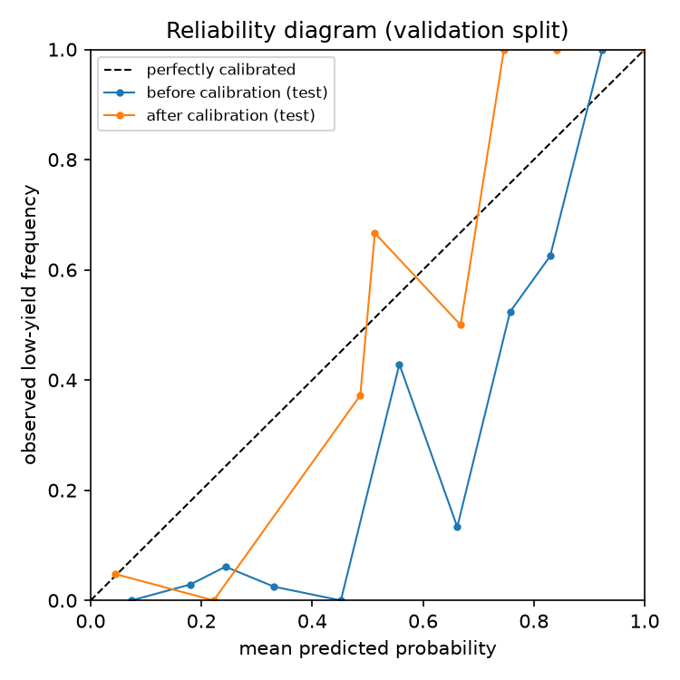
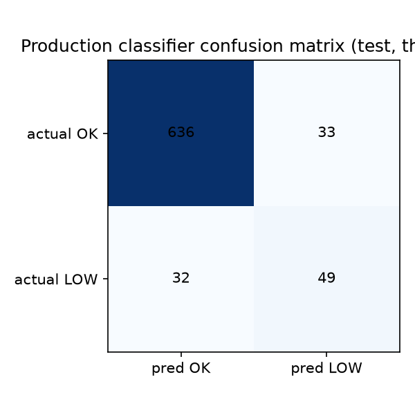

# Tabular model comparison (Phase 2A)

**Dataset:** synthetic v2 (`data/synthetic/`, DEMO / SIMULATED DATA), chronological split, train=3500 / val=750 / test=750.
**Leakage check:** train end `2026-07-23 04:47:36.334496+00:00` < val start `2026-07-23 05:16:49.284674+00:00` < test start `2026-08-18 22:22:24.229088+00:00` — passed.
**HPO:** fixed budget, 40 Optuna trials per model, seeded TPESampler, search on validation split only.

## Regression (lot yield %) — test split

| Model | MAE | RMSE | R² |
|---|---|---|---|
| mean_predictor | 5.33 | 6.19 | -0.000 |
| ridge | 3.31 | 4.96 | 0.358 |
| random_forest | 3.42 | 4.77 | 0.406 |
| xgboost_default | 3.22 | 4.89 | 0.376 |
| xgboost_tuned | 2.99 | 4.71 | 0.421 |

Tuned XGB best val RMSE: 4.429; params: `{"n_estimators": 250, "max_depth": 6, "learning_rate": 0.0169503183976245, "subsample": 0.8127230017888228, "colsample_bytree": 0.7332677505778558, "min_child_weight": 4.52367898813139, "reg_lambda": 0.023316192947732687}`.

## Classification (is_low_yield) — test split

| Model | Precision | Recall | F1 | ROC-AUC |
|---|---|---|---|---|
| base_rate_predictor | 0.000 | 0.000 | 0.000 | 0.500 |
| logreg | 0.551 | 0.605 | 0.576 | 0.813 |
| random_forest | 0.605 | 0.605 | 0.605 | 0.837 |
| xgboost_default | 0.598 | 0.605 | 0.601 | 0.832 |
| xgboost_tuned_calibrated | 0.598 | 0.605 | 0.601 | 0.831 |

Tuned XGB best val F1: 0.659; params: `{"n_estimators": 200, "max_depth": 5, "learning_rate": 0.010093441859229193, "subsample": 0.7293292683306493, "colsample_bytree": 0.7764434511091257, "min_child_weight": 2.833299793613665, "reg_lambda": 0.8996423850424297}`.

## Probability calibration (isotonic, fit on validation)

- ECE (val): 0.1764 → 0.0000
- ECE (test): 0.1826 → 0.0173
- Decision threshold re-picked on validation after calibration: **0.486** (calibration rescales scores, so 0.5 is no longer the F1-optimal operating point).

## Feature importance — production classifier (XGBoost gain, top 15)

| Feature | Gain |
|---|---|
| gas_flow_time_outside_pct | 198.2 |
| pressure_std | 179.3 |
| gas_flow_excursions | 156.0 |
| rf_power_std | 133.6 |
| gas_flow_std | 113.3 |
| rf_power_excursions | 86.5 |
| rf_power_time_outside_pct | 75.0 |
| pressure_excursions | 53.6 |
| equipment_ETCH_008 | 39.3 |
| equipment_LITHO_004 | 37.2 |
| pressure_time_outside_pct | 36.5 |
| rf_power_drift | 34.9 |
| equipment_ETCH_006 | 34.0 |
| equipment_CVD_006 | 33.7 |
| process_step_CVD | 31.7 |

## Feature importance — mean |SHAP| over a test sample (top 15)

| Feature | mean \|SHAP\| |
|---|---|
| pressure_std | 0.4269 |
| rf_power_std | 0.2200 |
| gas_flow_std | 0.1789 |
| pressure_excursions | 0.1616 |
| rf_power_excursions | 0.1481 |
| equipment_age_days | 0.1129 |
| previous_5_lot_yield | 0.0585 |
| pressure_drift | 0.0523 |
| rf_power_mean | 0.0504 |
| chamber_previous_yield | 0.0402 |
| gas_flow_max | 0.0386 |
| process_step_CVD | 0.0356 |
| gas_flow_excursions | 0.0343 |
| pressure_time_outside_pct | 0.0343 |
| rf_power_time_outside_pct | 0.0319 |

## Honest reading

- All numbers are measured on the chronological test split; synthetic data only, so they describe the simulator's fault physics, not a real fab.
- If a tuned model does not beat the simple baselines on a metric, the table shows it — the point of this report is comparison, not a story.
- Calibration is evaluated on both val (fit) and test (honest); if test ECE does not improve, the calibrator is overfit to validation and should not be trusted.